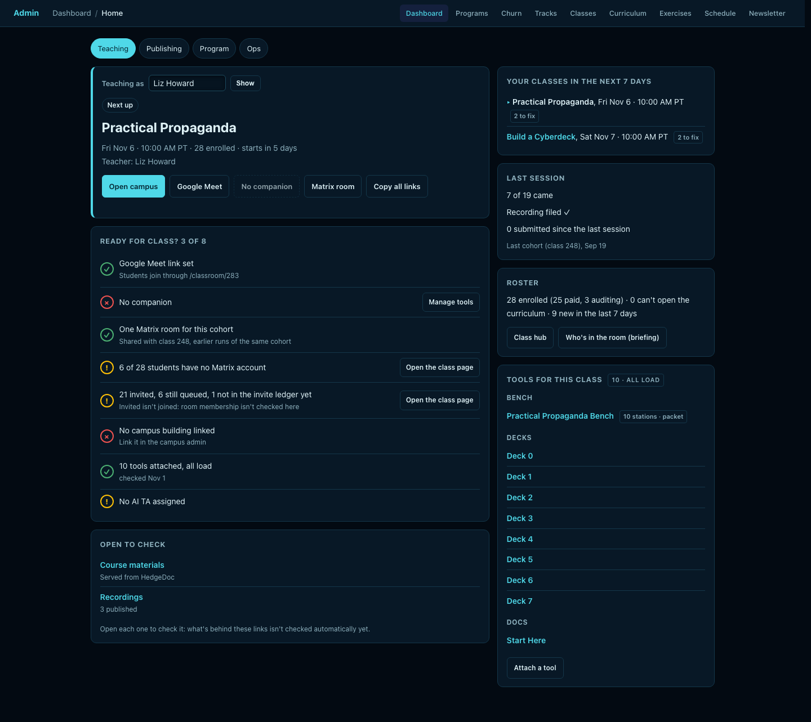
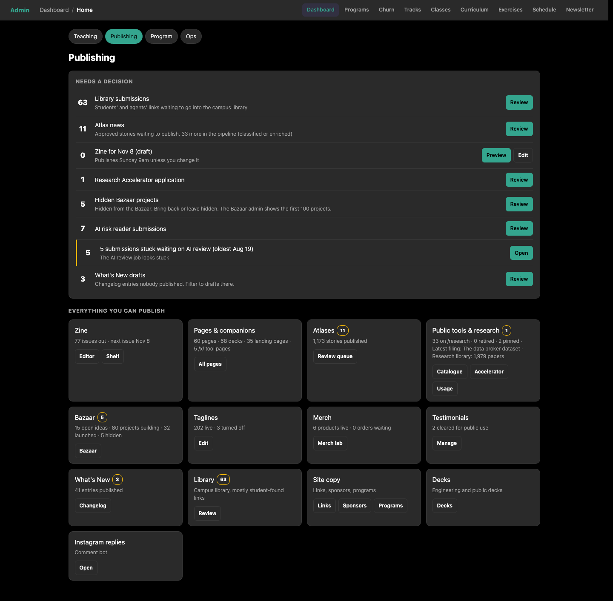

# Admin Home: Where to Find Things

**Where**: [`/admin/home`](https://themultiverse.school/admin/home). The old [`/admin/dashboard`](https://themultiverse.school/admin/dashboard) still works.

**Switching views:** every Admin Home tab has **Switch to old view**, and the old dashboard has **Switch to new view** at the top. [`/admin`](https://themultiverse.school/admin) opens whichever one you switched to last, in that browser.

Admin Home splits the admin side by job. Each tab opens with what needs a decision, and every row has a button that takes you to the screen where you act on it.

| Tab | Who it's for | What it answers |
|---|---|---|
| [Teaching](https://themultiverse.school/admin/home/teaching) | Whoever teaches the next session, plus admins | Am I ready for class, and where are all the links? |
| [Publishing](https://themultiverse.school/admin/home/publishing) | Admins | What's waiting for someone to approve, and where do I publish things? |
| [Program](https://themultiverse.school/admin/home/program) | Admins | How is the school doing, and what needs doing this week? |
| Ops | Admins | For now, a link back to the old dashboard. Its cards move here later. |

Numbers on these tabs come from the same place as the screen each button opens, so a count of 11 on Admin Home means 11 on the screen behind it. If one section can't load, that card says "Couldn't load …" and the rest of the page still works. Reload, and if it persists, tell the dev team.

---

## Teaching tab

**Who can open it:** admins, and any teacher whose account matches a teacher on a class (by account or by email). A teacher sees only their own classes. Being faculty on its own doesn't open it. Someone with no classes sees a short "no classes to teach" page.

**Admins:** use **Teaching as** at the top to see the page exactly as a given teacher would. Use it before class to check a guest teacher's setup.

### What's on it

- **Next up**: the next session. The buttons are:
  - **Open campus**: the class's building in the virtual campus. Starting a class happens inside campus.
  - **Google Meet**: the class's join link, `/classroom/<id>`. It sends people to Meet or campus, whichever the class uses.
  - **Companion**: the class's day companion, if one is bound.
  - **Matrix room**: the cohort's chat room.
  - **Copy all links**: copies a ready-to-paste block for the chat. It always includes the `/classroom/<id>` join link.
- **Ready for class? (N of 8)**: each check is green (fine), yellow (worth a look) or red (fix before class).

| Check | Red or yellow means | Where to fix it today |
|---|---|---|
| Google Meet link set | The class has no Meet link | Class edit page, Meeting link |
| Companion | No companion page bound to this course, or the bound one points at a different class | Manage tools, or ask the dev team |
| Matrix room | No cohort room, or the room is shared with a different course | Class edit page, or ask the dev team |
| Matrix accounts | Some enrolled students have no Matrix account yet | Class page. They need to make an account before they can be invited |
| Invites | Some invites failed or are still queued. "Invited" doesn't mean they've joined | Class page |
| Campus building | The class isn't linked to a building in campus | Campus admin, or ask the dev team |
| Tools | Some attached tools didn't load at the last nightly check | Manage tools |
| AI TA | No AI agent is assigned to this class on campus | Campus admin |

- **Open to check**: course materials and the recordings index. Nothing checks these automatically yet, so open them yourself before class.
- **Your classes in the next 7 days**: each one with a "N to fix" count. Click one to switch to it.
- **Last session**: who came (Meet joins plus campus calls, counted once each, teachers excluded), whether the recording is filed, and submissions since. A first session shows the previous run of the same course, labelled "Last cohort".
- **Roster**: paid vs auditing, and who's new. "New" means since the last class, or in the last 7 days when the last class was another cohort's.
- **Tools for this class**: the benches, decks and docs attached to the course, with **Attach a tool**.

The Fix buttons that make changes for you come in a later update. For now each red or yellow row tells you where to go.

---

## Publishing tab

### Needs a decision

Each row is a queue with a count and a **Review** button. Empty queues disappear.

| Row | What it is | Button opens |
|---|---|---|
| Library submissions | Links students and agents want in the campus library | Campus Library tab |
| Atlas news | Stories approved and waiting to publish. The note counts the ones still being processed | [`/admin/atlas-review`](https://themultiverse.school/admin/atlas-review) |
| Zine for <date> (draft) | Next Sunday's issue. **Preview** shows it as readers will see it, without publishing | [`/admin/newsletter`](https://themultiverse.school/admin/newsletter) |
| Research Accelerator | New applications | [`/admin/research/accelerator`](https://themultiverse.school/admin/research/accelerator) |
| Hidden Bazaar projects | Projects hidden from the Bazaar: bring back or leave hidden | Bazaar admin. Its list shows the first 100 projects only |
| AI risk reader submissions | Reader-submitted AI risk items | [`/admin/ai-risk-submissions`](https://themultiverse.school/admin/ai-risk-submissions) |
| Community submissions stuck (yellow) | Submissions waiting more than 48 hours for their automatic review. **The review job is stuck: tell the dev team** | [`/admin/community-submissions`](https://themultiverse.school/admin/community-submissions) |
| What's New drafts | Changelog entries nobody published | [`/admin/pages?page_type=changelog`](https://themultiverse.school/admin/pages?page_type=changelog). Filter to drafts there |

### Everything you can publish

One tile per area, each with its count and buttons:
- Zine
- Pages & companions
- Atlases
- **Public tools & research**: what's on [/research](https://themultiverse.school/research). Publish, pin or retire entries in the **Catalogue**. Choose the "Latest filing" there too.
- Bazaar
- Taglines
- Merch
- Testimonials
- What's New
- Library
- Site copy
- Decks
- Instagram replies

---

## Program tab

**The numbers along the top:**
- MRR, compared with last month's membership revenue
- Revenue this month (it matches Financials)
- New people this week
- How many of them bought something
- Paying members (no scholarships or admins)
- Scholarship applications in the last 30 days

**Charts.** Hover a bar, or tap it on a phone, for its numbers. On a phone the members chart shows 13 weeks, and the full 26 are in the **Weekly numbers** table under it.
- **Members coming and going**: joined (first membership bought) vs lapsed (membership ran out and wasn't renewed), per week for 26 weeks.
- **Expiring, next 5 weeks**: memberships that run out each week, so you can reach out before they do.
- **Revenue by month**.

**What needs doing**, top to bottom:

| Row | What to do |
|---|---|
| Classes in the next 7 / 30 days | Flagged when fewer than 3 classes run this week. Plan schedule |
| Core classes with no date | A core class has nothing on the calendar. Schedule its next run |
| No security class in <month> | Every month needs at least one security class. Schedule one |
| Billing and access disagree | People Stripe still charges whose access has run out. Fix access on [`/admin/churn`](https://themultiverse.school/admin/churn) |
| Payment failing / Cancelling or ending / At risk | Reach out from [`/admin/churn`](https://themultiverse.school/admin/churn). When Stripe can't be read these show "?" instead of a number. That's on purpose, so don't trust a zero then |
| Access dates in the next 14 days | Includes people on auto-renew, so not everyone here is leaving |
| Recently churned / No path, gone quiet | Win-back and path suggestions on the churn page |
| Payroll and platform costs last updated … | Shown once costs are over 30 days old. Update costs on [`/admin/financials`](https://themultiverse.school/admin/financials) |

**Core and security classes.** These are fixed lists, not something the page guesses:
- **Core**: Intro to Open Source Software, Solarpunk Automation, Intro to Interactive Fiction, Business Automation, Agentic SDLC, Data Activism, Practical Propaganda.
- **Security**: Digital Identity Defense, Home Network Defense, Consumer Device Rescue, Scam and Fraud Defense, AI Security Governance.

To change either list, ask the dev team. They live in the `program_class_lists` table, and an admin screen for them hasn't been built yet.

**Find a student**: type 2 or more letters of a name, email or Matrix id. Results open that student's CRM page.

**Upcoming classes**: every class that's still running, soonest first. It's the same list the old dashboard had. Each class has these buttons:
- **Edit**: the class settings.
- **Hub**: the class hub.
- **Live**: the live view during a session.
- **Roster**: the student list for that class.
- **Curriculum**: edit the class's curriculum.
- **Exercises**: the class's exercises.
- **Prep**: opens the Teaching tab as that class's teacher.

**Create a class** is at the bottom.

**Every screen**: a button for every admin page, in these groups:
- Money
- Programs & schedule
- Classes & curriculum
- Students
- Founding Federation (FF admin home, progress, funnels and the member home)
- Mutual aid
- Community
- Reports & experiments
- Ops
- Help & reference (this handbook, the old dashboard, docs)

If a page you used to reach from the old dashboard isn't here, tell the dev team. A check fails whenever an admin page has no button here, so it's a bug.

---

## How do I…

| I want to… | Go to |
|---|---|
| Get ready to teach / grab all the class links | Teaching tab → Copy all links |
| See a guest teacher's setup | Teaching tab → Teaching as |
| Find out who came last session | Teaching tab → Last session |
| Approve library or atlas items | Publishing tab → Needs a decision |
| Preview the next zine | Publishing tab → Zine → Preview |
| Publish, pin or retire a tool on /research | Publishing tab → Public tools & research → Catalogue |
| See MRR and revenue | Program tab, top row. Details on [`/admin/financials`](https://themultiverse.school/admin/financials) |
| See who's cancelling or at risk | Program tab → What needs doing → [`/admin/churn`](https://themultiverse.school/admin/churn) |
| Check whether a core class is scheduled | Program tab → Core classes with no date |
| Look up a student | Program tab → Find a student |
| Edit a class, open its roster, hub or curriculum | Program tab → Upcoming classes |
| Create a class | Program tab → Upcoming classes → Create a class |
| Get to FF admin | Program tab → Every screen → Founding Federation |
| Get to any other admin page | Program tab → Every screen |
| Go back to the old dashboard | Switch to old view, on any tab |
